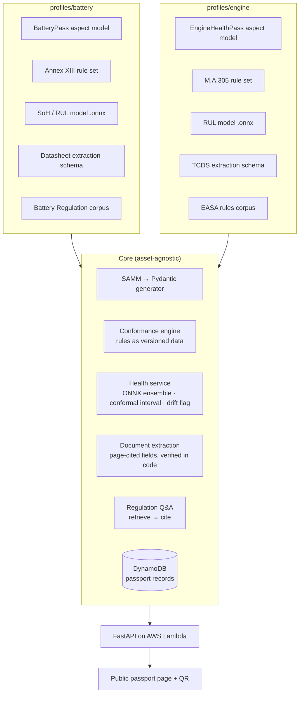
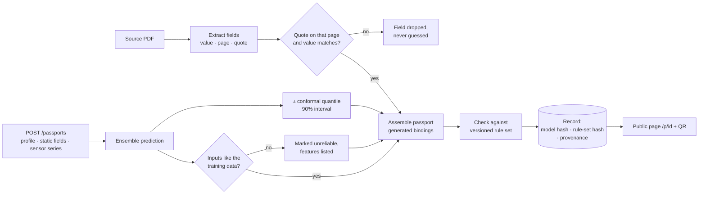
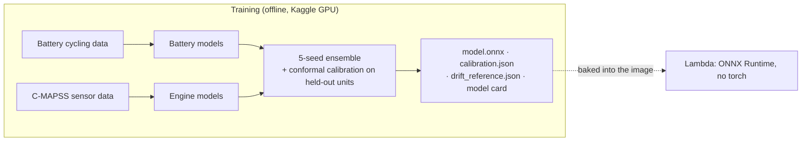
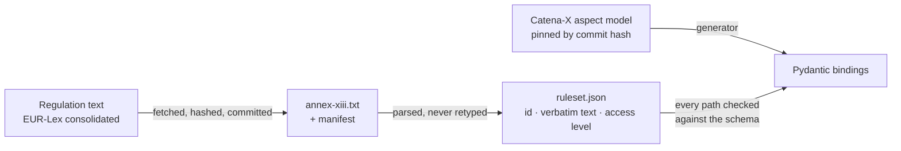

# Asset Health Passport

A digital passport for **assets that wear out**. For each asset it:

1. builds a passport document from a published standard's aspect model,
2. checks that passport against the rules that apply to the asset, cluster by cluster,
3. predicts how much life the asset has left, with a calibrated uncertainty interval and
   a warning when the input looks unlike anything the model was trained on,
4. fills the static fields from source documents, where every value cites the page and
   the exact quote it came from,
5. answers questions about the governing regulation, citing the article or paragraph,

and serves the result as a public page addressable by QR code.

The core does not know which kind of asset it is handling. Each asset type is a **profile**,
a folder of data and artefacts:

| | **Battery** (automotive) | **Turbofan engine** (aerospace) |
|---|---|---|
| Why a passport | EU Battery Regulation 2023/1542: digital battery passport mandatory from 18 Feb 2027 | EASA continuing-airworthiness record-keeping (Part-M) and predictive maintenance |
| Passport schema | Catena-X `io.catenax.battery.battery_pass` (SAMM) | `EngineHealthPass`, a SAMM aspect model written for this project; nameplate aligned to the IDTA Digital Nameplate |
| Rules checked | Annex XIII mandatory attributes, seven clusters | Record items from Part-M M.A.305, each check citing its paragraph |
| Health estimate | State of health (% capacity) and remaining useful life | Remaining useful life (cycles) |
| Training data | Severson / MIT–Stanford LFP cells; NASA PCoE and Oxford for transfer | NASA C-MAPSS FD001–FD004 |
| Source documents | Cell datasheets | EASA Type Certificate Data Sheets |
| Regulation corpus | Regulation (EU) 2023/1542, English and German (EUR-Lex) | EASA Easy Access Rules for Continuing Airworthiness |

> **Not a certified measurement, and not an airworthiness tool.** Every health figure is a
> statistical estimate from a research model trained on public laboratory or simulation
> data. It ships with an interval saying how far to trust it, and must not be used for a
> safety, warranty, resale or maintenance decision. There is no EU "engine passport"
> mandate: the engine profile shows the same method on public data and makes no
> airworthiness determination.

---

## How it fits together

### One core, pluggable profiles



A profile holds data, never logic. Adding a third asset type means adding a folder.

### What happens when a passport is created



Every number on a passport can be traced. The health value carries the SHA-256 of the
model file that produced it, each extracted field carries its page and quote, and the
conformance result carries the version and hash of the rule set it was checked against.

### Training versus serving



Training needs PyTorch and a GPU. Serving needs ONNX Runtime and a CPU. Only the exported
artefacts cross between them, and CI fails the build if `torch` ever appears under `src/`.
The reason is cold start: a CPU-only torch is roughly 700 MB, onnxruntime about 50 MB.

### Where the rules come from



The rule set is built from the regulation itself, not from the aspect model's
documentation, which leaves out six of the 28 mandatory points. If the regulation's
wording changes, the loader refuses the rule set until the mapping is reviewed again.

---

## Tech stack

| Layer | Choice |
|---|---|
| Language | Python 3.12, managed with `uv` |
| Schema | SAMM aspect models (Turtle) → rdflib → generated Pydantic v2 bindings |
| AAS export | `aas-core3.0` / BaSyx Python SDK |
| Training | PyTorch (1D CNN, LSTM), scikit-learn baselines (elastic net, gradient boosting) |
| Uncertainty | Deep ensembles + split conformal prediction |
| Drift | Per-feature PSI / KS tests against a stored training reference |
| Serving inference | ONNX Runtime |
| Document extraction | pdfplumber page text + an LLM with structured output, behind one `Extractor` interface: a QLoRA-fine-tuned open model or the Claude API |
| Regulation Q&A | Multilingual embedding model in ONNX, NumPy index, extractive cited answers |
| Experiment tracking | MLflow (local) |
| API | FastAPI + Pydantic v2 |
| Compute / storage | AWS Lambda (arm64 container, Function URL) + DynamoDB, `eu-central-1` |
| Frontend | React + TypeScript + Vite, served from the same container |
| Model hosting | Hugging Face Hub |
| CI | GitHub Actions: lint, types, tests, and checks on pinned models, generated code and rule sets |

## Code layout

| Path | Owns |
|---|---|
| `src/bpass/core/` | The domain contract. Depends on nothing but Pydantic; strict-typed |
| `src/bpass/samm/` | SAMM Turtle → Pydantic generator. Knows RDF, not any asset |
| `src/bpass/bindings/` | Generated aspect-model bindings. Committed, never hand-edited |
| `src/bpass/conform/` | Rule-set loading, versioning and per-cluster checks |
| `src/bpass/passport/` | Assembly, provenance and the record store |
| `src/bpass/api/` | FastAPI routes. Transport only |
| `training/` | The only place `torch` is imported |
| `samm-models/` | Pinned Catena-X aspect models, hashed |
| `rulesets/` | Verbatim regulation text and rule data, hashed |
| `scripts/` | Fetch, pin and verify upstream sources; the torch guard |
| `docs/adr/` | Why things are the way they are |

## Measured so far

| Metric | Value |
|---|---|
| Aspect-model entities bound | 65 |
| Properties whose payload name differs from their model name | 105 |
| Annex XIII mandatory points encoded | 28 |
| Of those, dynamic fields that need refreshing | 4 |
| Passport paths mapped, all resolving against the schema | 37 |

Model accuracy, interval coverage, extraction precision and latency appear here only once
they are measured on a real run.

## Local development

```bash
uv sync --all-extras
uv run pytest
uv run python scripts/no_torch_in_src.py
```

Upstream sources are pinned and verified against manifests. Fetching is only needed after
changing a pin:

```bash
uv run python scripts/fetch_samm.py --check              # aspect models match their hashes
uv run python -m bpass.samm.generate --check             # committed bindings are current
uv run python scripts/fetch_annex_xiii.py --check        # regulation text matches its manifest
uv run python scripts/build_annex_xiii_ruleset.py --check  # rule set matches a fresh build
```

Training has its own environment, so that torch can never enter `uv.lock`:

```bash
pip install -r training/requirements.txt
```

## Non-negotiables

Enforced by tests and CI, not by intention.

1. **`src/` never imports `torch`**, and torch never appears in the runtime dependencies.
2. **Generated bindings are never hand-edited.** CI regenerates them and fails on any
   difference. The generator stops on any SAMM construct it does not support rather than
   emitting `Any`.
3. **Rule sets are versioned data, never constants.** Every record carries
   `ruleset_version` and `ruleset_sha256`.
4. **Every health estimate carries `model_sha256`**, the hash of the bytes that produced it.
5. **Split by unit, never by time step** (cell or engine), and commit the split. Validation
   and calibration units are carved out of training; official and transfer test sets are
   used exactly once and never tuned on.
6. **Respect the observation window.** No feature, normalisation statistic included,
   touches data past it.
7. **No extracted value without a verified citation.** If the quote is not on the cited
   page, the field is dropped.
8. **No regulation answer without a retrieved citation.** Otherwise it refuses.
9. **Never claim certification.** The service checks against a published reading of the
   rules.
10. **Every number in this README comes from a real run.**

## Out of scope

Catena-X network onboarding and certification, dataspace connectors, verifiable
credentials and wallets, carbon-footprint methodology, supply-chain due-diligence data
collection, and any maintenance-planning or airworthiness function. The passport is
exposed in the Asset Administration Shell submodel shape a connector would sit in front
of, but the dataspace plumbing itself is not built.

## References

- Catena-X semantic models: [`eclipse-tractusx/sldt-semantic-models`](https://github.com/eclipse-tractusx/sldt-semantic-models); standards CX-0143 and CX-0003
- Regulation (EU) 2023/1542, Article 77 and Annex XIII
- Severson et al., *Data-driven prediction of battery cycle life before capacity degradation*, Nature Energy 2019
- NASA PCoE battery datasets · Oxford Battery Degradation Dataset · NASA C-MAPSS
- EASA Easy Access Rules for Continuing Airworthiness (Regulation (EU) No 1321/2014)
- EASA Type Certificate Data Sheets · IDTA Digital Nameplate submodel template

## Licence

Source-available for reading and evaluation. See [LICENSE](LICENSE). Upstream aspect
models and datasets carry their own licences.
