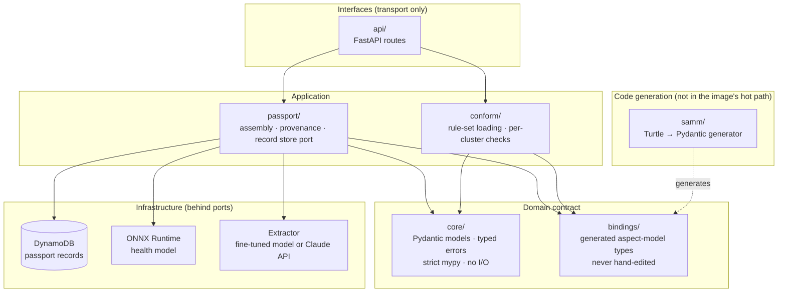
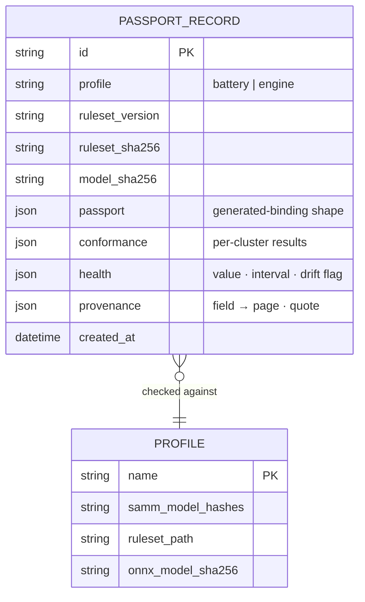

# Architecture — engineering map

> `README.md` holds the public-facing picture (one core, pluggable profiles; the passport
> creation flow; training versus serving; where the rules come from). This file is the
> engineer's map: which module owns what, how the layers depend on each other, the
> cross-cutting concerns, and where the system will strain. **It is updated in the same PR
> as any change that adds, removes or re-wires a module, dependency, table or external
> call.** If it disagrees with the code, that is a bug.

## 1. Layers inside `src/bpass/`

Dependencies point **inward**: `api` → `passport` / `conform` → `core` + `bindings`.
Infrastructure is reached only through interfaces defined in the application layer
(ADR-0007 names the repository port). `profiles/` and `training/` are outside the package:
the first is data the core reads, the second produces artefacts the core loads.

## 2. Module inventory

| Module | Owns | Depends on | Status | Decided in |
|---|---|---|---|---|
| `core/` | Domain models (`models.py`), typed errors, the contract everything else uses | Pydantic only | built | ADR-0003 |
| `samm/` | `loader.py` reads Turtle, `walk.py` traverses the aspect model, `model.py` is the intermediate form, `emit.py` writes Python, `generate.py` is the CLI with `--check` | rdflib (codegen extra) | built, property-tested | ADR-0001 |
| `bindings/` | Generated Pydantic bindings for the pinned Catena-X models | core | generated | ADR-0001 |
| `conform/` | `ruleset.py` loads/verifies versioned rule sets, `paths.py` resolves passport paths against the schema | core, bindings | built | ADR-0002 |
| `passport/` | Assembly, provenance (`model_sha256`, `ruleset_sha256`, citations), record store port | core, conform, bindings | scaffold | ADR-0007 |
| `api/` | FastAPI routes, error → HTTP mapping | passport, conform | scaffold | ADR-0007 |
| _health service_ | ONNX ensemble, conformal interval, drift flag | core | not started | ADR-0004, ADR-0005 |
| _document extraction_ | pdfplumber + `Extractor` interface, citation verification | core | not started | ADR-0006 |
| _regulation Q&A_ | embedding index, extractive cited answers | core | not started | ADR-0006 |
| `profiles/battery/` | Pinned SAMM models (hashed, `sources.json`), Annex XIII rule set | — | built | ADR-0002, ADR-0003 |
| `training/` | PyTorch training, ONNX export, parity check | torch (own env) | requirements only | ADR-0004 |
| `scripts/` | Fetch/pin/verify upstream sources; `no_torch_in_src.py`; doc helpers | — | built | ADR-0004 |

_Update the Status column as modules land. Each "not started" row should gain a
`docs/design/` doc before code is written._

## 3. Key flows

| Flow | Diagram lives in | Design doc |
|---|---|---|
| Passport creation (POST → health → extract → assemble → check → record → page) | `README.md` "What happens when a passport is created" | _to write: `docs/design/passport-creation.md`_ |
| Code generation (SAMM Turtle → bindings, `--check` in CI) | `README.md` "Where the rules come from" | — (ADR-0001 covers it) |
| Rule-set build (EUR-Lex text → `ruleset.json`, hashed) | `README.md` "Where the rules come from" | — (ADR-0002 covers it) |
| Training → export → parity → bake into image | `README.md` "Training versus serving" | _to write before `training/` grows_ |

## 4. Data model (records, high level)

_The single-table DynamoDB layout and access patterns are a design-doc item before the
store is implemented (see §7)._

## 5. Cross-cutting concerns

| Concern | Approach | Where | State |
|---|---|---|---|
| Configuration | pydantic-settings from environment | _to be: `core/settings.py` or `api/settings.py`_ | planned |
| Logging | structlog JSON with request id on every entry | `api/` middleware | planned |
| Errors | typed exceptions in `core/`, mapped to HTTP codes in `api/` | `core/`, `api/` | partial |
| Provenance | hashes and citations stored with the record, never recomputed | `passport/` | planned (ADR-0005/6) |
| Timeouts / retries | per-client defaults; retries only on idempotent ops | DynamoDB client, Extractor | planned |
| Integrity of inputs | pinned upstream sources verified by hash in CI | `scripts/fetch_*.py --check` | built |
| Serving-image size | torch guard; every dependency weighed in `pyproject.toml` comments | `scripts/no_torch_in_src.py`, CI | built |

## 6. Serving-image budget

Cold start is the governing constraint (ADR-0004, ADR-0007). Keep this table honest:

| Component | Approx. size | Note |
|---|---|---|
| onnxruntime | ~50 MB | the reason torch is excluded (~700 MB) |
| numpy | ~30 MB | preprocessing only; pandas excluded |
| boto3 | ~15 MB | DynamoDB only |
| ONNX models + embedding index | _measure_ | baked in; per profile |
| React build | _measure_ | served from the same container |

## 7. Scale notes

Stated scale: research/portfolio, bursty QR-scan traffic, zero budget.

- **First thing to strain at 10×:** cold starts under a burst (many concurrent Lambda
  instances each paying the full import). Mitigation when needed: provisioned
  concurrency (costs money) or a smaller image.
- **At 100×:** DynamoDB on-demand is fine; the LLM extraction step on the request path
  would not be. It should already be off the QR-scan path (extraction happens at passport
  creation, not at page view).
- **Decisions deferred until needed:** caching of public pages at the edge; separate
  read model for the public page; multi-region.

## 8. Decision log

See `docs/adr/README.md` for the full index. The seven accepted records, in the order a
new engineer should read them:

1. ADR-0003 — one asset-agnostic core, profiles as data (why the repo is shaped this way)
2. ADR-0001 — generate bindings from SAMM (why `bindings/` is never edited)
3. ADR-0002 — rules as versioned data (why `ruleset.json` carries a hash)
4. ADR-0004 — train in PyTorch, serve ONNX (why `torch` is banned from `src/`)
5. ADR-0005 — ship a calibrated interval and a drift flag
6. ADR-0006 — trust LLM output only through citations verified in code
7. ADR-0007 — one container on Lambda, DynamoDB behind a repository port
