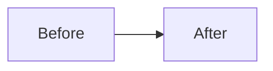

# NNNN — <Short title, stated as the decision: "Serve ONNX, train in PyTorch">

**Status:** Proposed · **Date:** YYYY-MM-DD

<!--
Project ADR style (see README.md in this folder):
  - Record only decisions that were expensive to make and would be expensive to reverse.
  - Context → Decision → Consequences. The rejected alternative is REQUIRED; a record
    that only argues for the chosen option documents a conclusion, not a decision.
  - Accepted records are never rewritten. A changed decision gets a new record; the old
    one gains "**Status:** Superseded by NNNN".
  - Statuses: Proposed · Accepted · Superseded by NNNN · Deprecated
  - Prose, not bullet soup. Concrete numbers where they exist.
  - Delete this comment block in the real record.
-->

## Context

What situation forces a decision? Which constraints matter here: cold start, zero
budget, traceability, the non-negotiables in `README.md`? Give the numbers that make the
obvious option untenable, if that is the case.

## Decision

What we do, stated plainly. How it is enforced (a test, a CI step, a type) rather than
intended. If structure changes, a small diagram belongs here:

## Consequences

What it costs, what it buys, and what becomes a release step or a maintenance burden.

The rejected alternative was <X>. <Why it lost, in one or two sentences: the reason a
reader could not reconstruct from the code.>

<!-- Optional, for the owner's learning: -->
## Learning notes

The concept behind this decision in one short paragraph, and the glossary term(s) it
introduces (`docs/glossary.md`).
