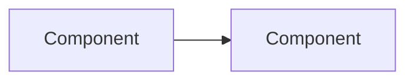
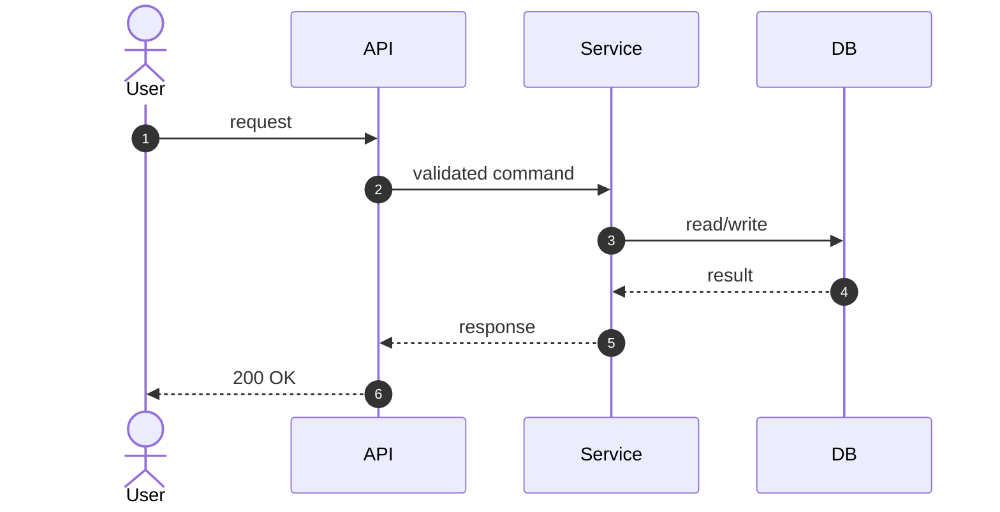
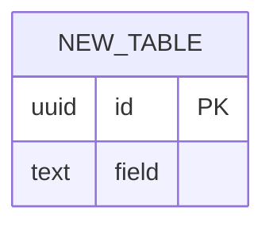

# Design: <feature name>

- **Status:** draft | approved | implemented | superseded
- **Date:** YYYY-MM-DD
- **Related ADRs:** ADR-XXXX, …
- **Owner:** <human> (reviewed) / <agent> (drafted)

## 1. Problem

What user/system need does this solve? What does "done" look like? 2–5
sentences. Include a concrete example input → output if applicable.

## 2. Constraints & assumptions

- Scale target (from `CLAUDE.md` §0): …
- Must integrate with: …
- Out of scope: …
- Assumptions I'm making that the human should confirm: …

## 3. Options

| | Option A | Option B | Option C |
|---|---|---|---|
| Summary | | | |
| Complexity | | | |
| Scales to 100×? | | | |
| Failure modes | | | |
| Recommendation | ✅ / ❌ | | |

**Recommendation:** Option _ because _.

## 4. Proposed design

### 4.1 Components touched

### 4.2 Main flow

### 4.3 Data changes

Migrations: …

### 4.4 Interfaces / contracts

Endpoints, function signatures, message schemas. Show request/response shapes.

### 4.5 Error handling & edge cases

| Case | Behaviour |
|---|---|
| Invalid input | 400 with field errors |
| Downstream timeout | retry N× with backoff (idempotent only), then 503 |
| Duplicate submission | idempotency key → return original result |

## 5. Robustness checklist

- [ ] Input validated at boundary
- [ ] Timeouts on all outbound calls
- [ ] Idempotent writes where retried
- [ ] Structured logs with request id
- [ ] Typed errors mapped at the edge
- [ ] Config via env, no secrets in repo

## 6. Scale review

- At 10× stated scale, the first thing that breaks is … because …
- At 100×, … We would change … (not doing it now because …).
- Indexes added and which query each serves: …

## 7. Test plan (write before code)

What could break?
- [ ] Unit: …
- [ ] Integration: …
- [ ] E2E: …

## 8. Rollout / migration

Feature flag? Backfill? Order of deploy steps? Rollback path?

## 9. Learning notes

New concepts introduced (link to `docs/glossary.md`), and the one thing the
human should take away from this design.
