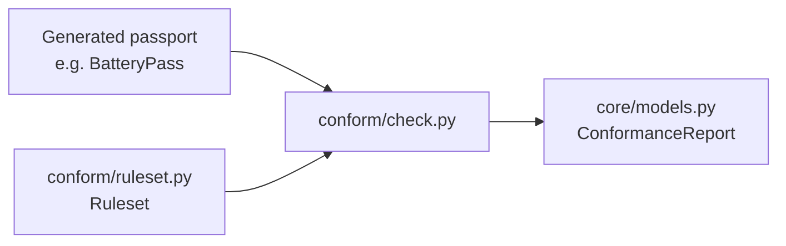
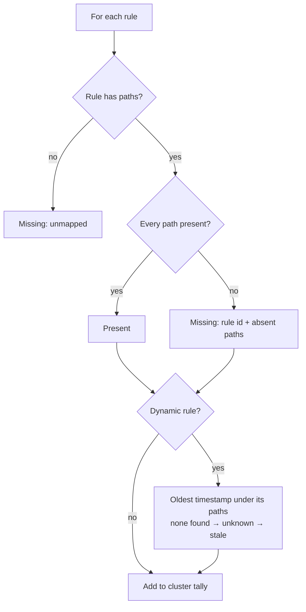

# Design: conformance checker

- **Status:** implemented
- **Date:** 2026-10-26
- **Related ADRs:** ADR-0002, ADR-0003
- **Owner:** Harshal (reviewed) / Claude (drafted)

## 1. Problem

The Annex XIII rule set loads and verifies, but nothing judges a passport against it. The
checker takes a validated passport, a rule set and the current time and returns a
`ConformanceReport`: per cluster, how many mandatory points are present and which are
missing, plus which dynamic fields are out of date.

Example: the official BatteryPass 6.1.0 example payload → 27 of 28 points present,
`materials` missing `XIII.2.b: no passport field models this point`, and the four Part 4
dynamic fields reported stale, because the example's timestamps are from 2023 and 4(c)
carries none at all.

## 2. Constraints & assumptions

- Scale target: research / portfolio, bursty QR traffic. The check runs once at passport
  creation, never on page view.
- Must integrate with: `conform/ruleset.py` (`Ruleset`, `Rule`), `core/models.py`
  (`ConformanceReport`, `ClusterCoverage`, `DynamicFieldState`), any generated binding.
- Out of scope: checking that values are *correct*, only that they are *present*;
  access-level enforcement (who may read what); the engine profile's rule set.
- Assumptions confirmed with the owner on 2026-10-26: the four presence rules in §4.4.

## 3. Options

| | A: walk the dumped payload | B: walk the Pydantic instance | C: JSONPath library |
|---|---|---|---|
| Summary | `model_dump(by_alias=True)`, walk dicts and lists by payload name | `getattr` through the model, mapping payload names back to field names | Translate rule paths to JSONPath, evaluate |
| Complexity | ~60 lines, stdlib only | Needs the alias lookup `paths.py` already does, plus list handling | New dependency; list semantics still ours to define |
| Scales to 100×? | Yes; microseconds per passport | Yes | Yes |
| Failure modes | A field name differing from its payload name is handled by the dump | Easy to confuse field and payload names | Dependency weighed against cold start for no gain |
| Recommendation | ✅ | ❌ | ❌ |

**Recommendation:** A. Rule paths are payload names, and the dump is the payload. The
path's *validity* against the schema is already proven by `paths.py` in CI; the checker
only answers whether this passport carries it.

## 4. Proposed design

### 4.1 Components touched



### 4.2 Main flow



### 4.3 Data changes

`DynamicFieldState.last_refreshed_at` becomes `datetime | None`. `None` means the passport
carries no timestamp for the field, and `stale_at` treats it as stale: nothing proves the
value was refreshed. No stored records exist yet, so nothing migrates.

### 4.4 Interfaces / contracts

```python
def check(passport: BaseModel, ruleset: Ruleset, now: datetime) -> ConformanceReport
```

Pure: no I/O, no clock. `now` is passed in so the result is reproducible.

Presence rules (editorial, like the cluster mapping in ADR-0002):

1. **A rule with several paths needs all of them.** Each path is part of the point;
   point 1(b) is chemistry *and* hazardous substances *and* composition.
2. **A path through a list is present if at least one item carries the rest of it.**
   Annex XIII asks for an overall recycled share, not one per component.
3. **Empty is absent.** `None`, `""`, `[]` and `{}` do not count; `0` and `False` do.
4. **Freshness comes from the passport's own timestamps:** the oldest `datetime` found
   under a dynamic rule's paths. None found → unknown → stale.
5. **Missing items are named** `"<rule id>: <absent paths>"`, so the reader knows exactly
   what to collect.

### 4.5 Error handling & edge cases

| Case | Behaviour |
|---|---|
| Rule with no paths (2(b)) | Always missing, named as unmapped |
| Path does not exist in the schema | Counts as missing here; `paths.py` tests catch the mapping bug in CI |
| Dynamic field present, no timestamp anywhere under it | `last_refreshed_at=None`, reported stale |
| Naive timestamp in a payload | Read as UTC. `shortcut:` noted in code; upgrade if a real producer sends local times |
| Cluster with no rules | Cannot happen: the rule-set test requires a rule per declared cluster |

## 5. Robustness checklist

- [x] Input validated at boundary: the passport is already a validated binding; the rule
      set refuses tampering on load
- [x] Timeouts on all outbound calls: none made
- [x] Idempotent writes: no writes
- [ ] Structured logs with request id: not here; the caller logs
- [x] Typed errors mapped at the edge: the checker raises nothing of its own
- [x] Config via env: none needed

## 6. Scale review

- At 10×: nothing. One dump and 28 dictionary walks per passport creation, off the
  page-view path.
- At 100×: still nothing in the checker. If passports ever grow very large, cache the dump
  per request rather than per rule (it is already once per call).
- Indexes: none; no storage.

## 7. Test plan (write before code)

What could break?
- [x] Unit: the official example yields 27/28 present, only `XIII.2.b` missing.
- [x] Unit: removing one path of a multi-path rule makes the rule missing and names that path.
- [x] Unit: a list where only one item carries the field still counts as present (on a
      minimal model: no list in BatteryPass can hold an item without it, see §9).
- [x] Unit: empty string and empty list count as absent; `0` counts as present.
- [x] Unit: a dynamic rule without a refresh interval is refused by the loader.
- [x] Unit: dynamic fields stale with 2023 timestamps; fresh with recent ones; stale with
      no timestamp.
- [x] Unit: every declared cluster appears in the report, in rule-set order.
- [x] Unit: `DynamicFieldState` with no timestamp is stale.
- Integration / E2E: arrive with the passport creation flow.

## 8. Rollout / migration

None. New pure function; nothing calls it until passport creation lands.

## 9. Learning notes

New concept: **presence vs validity**. The checker judges whether a passport *carries*
each mandatory point, not whether the values are right. Validity of types is the
bindings' job; correctness of values is out of scope. Keeping those three apart is what
lets each be tested on its own.

Finding while testing: the generated binding already refuses a missing value for 35 of the
37 mapped paths, because the aspect model marks them required. So on a *valid* BatteryPass
the checker's real work is narrower than it looks: empty strings and lists (14 paths accept
them), the two optional fields in 4(d), the unmapped point 2(b), and freshness. The checker
still treats every path the same way, because a future aspect-model version can relax any
of those constraints without this code noticing.
