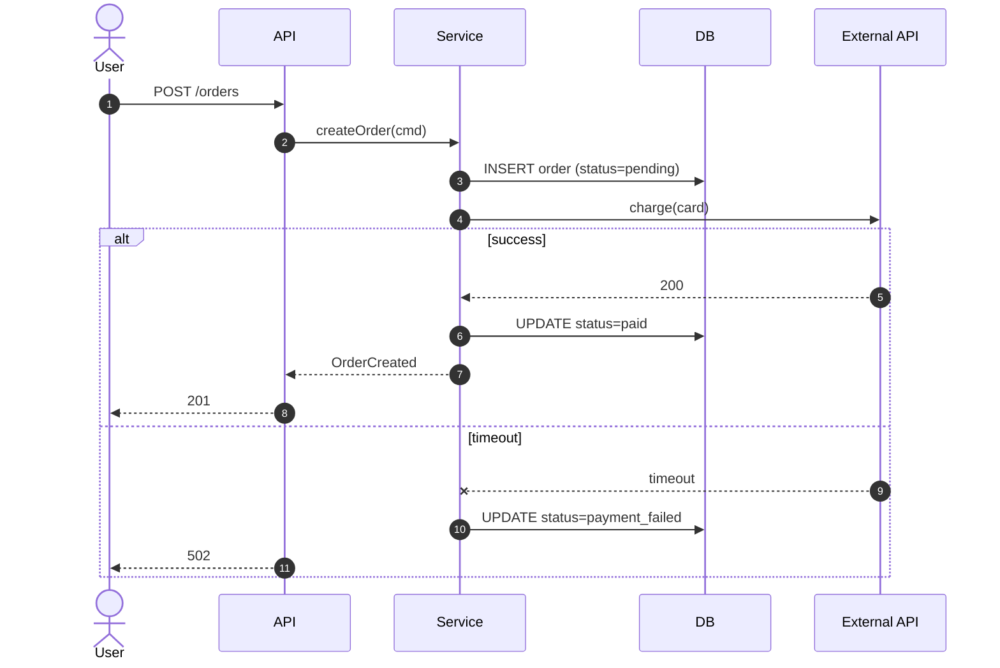
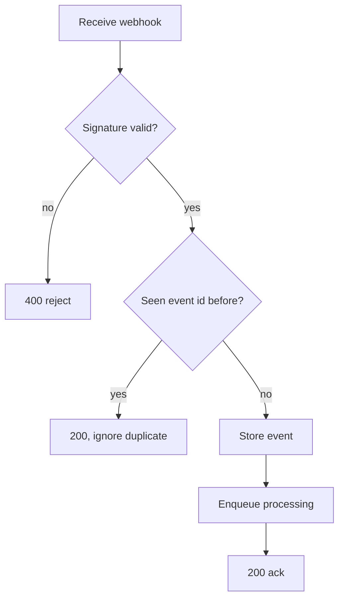
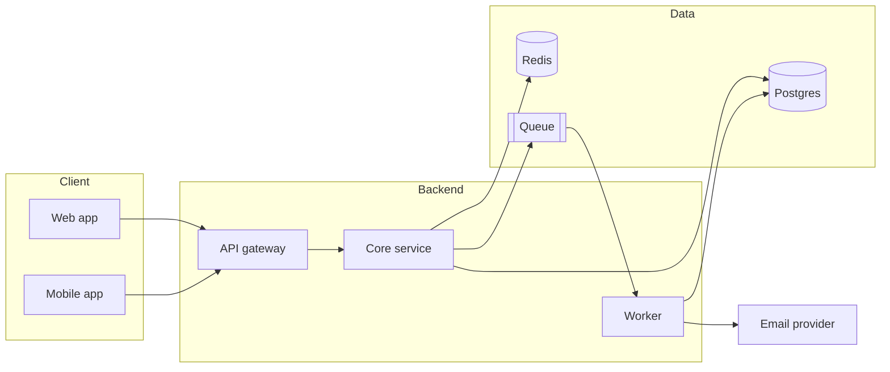
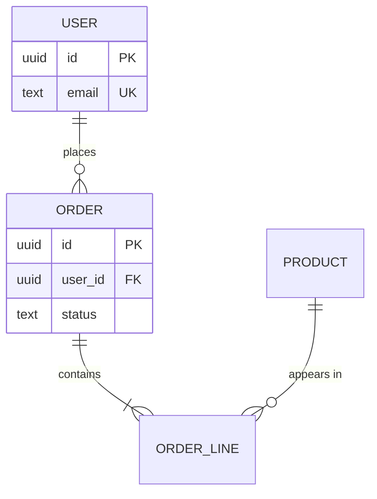
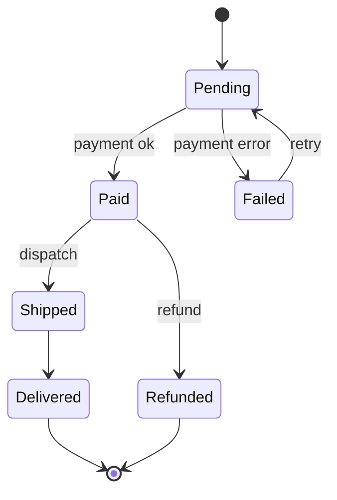
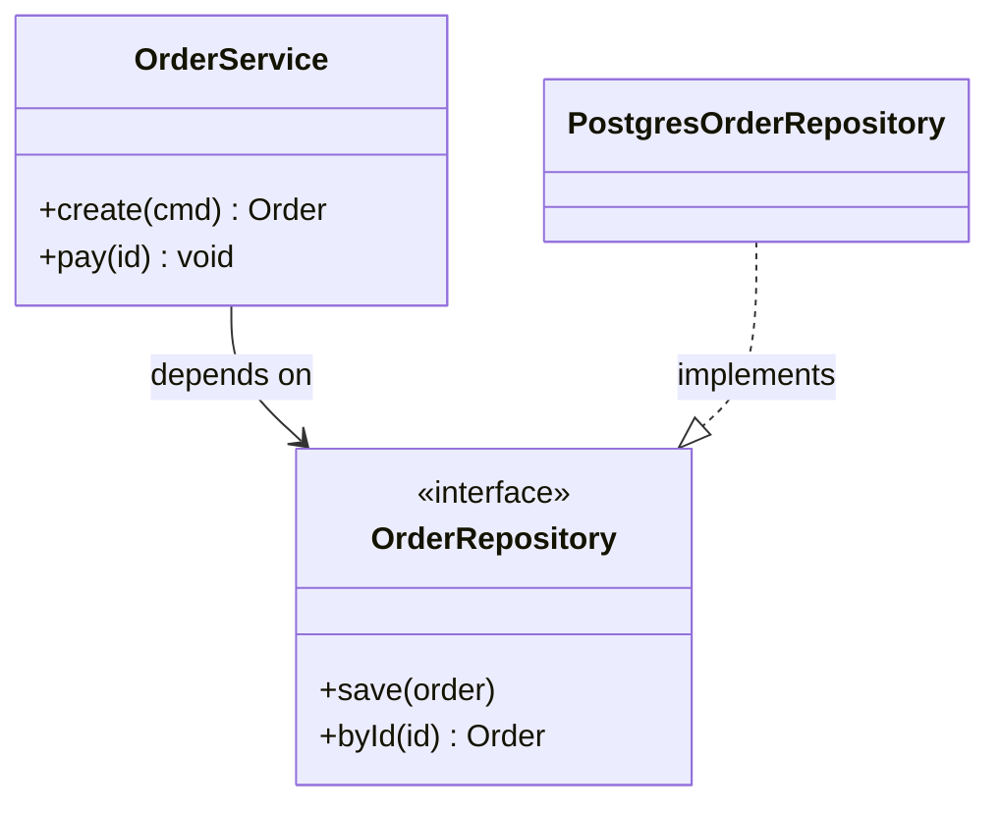
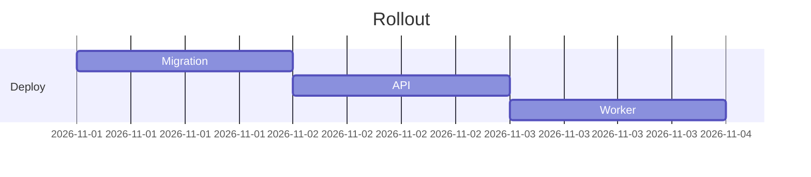

# Mermaid cheat sheet

All diagrams in this repo are Mermaid inside fenced code blocks. They render on
GitHub, GitLab, VS Code (Markdown Preview Mermaid extension), Obsidian, and
https://mermaid.live. Pick by the question you're answering.

## Sequence diagram — "who calls whom, in what order?"

Use for request flows, auth handshakes, retries, anything with time.

Tips: `->>` solid call, `-->>` dashed reply, `--x` failed, `alt/else`, `loop`,
`par` for concurrency, `Note over A,B: text`.

## Flowchart — "what are the branches?" / "what are the boxes?"

Shapes: `[rect]` `(rounded)` `([stadium])` `[(database)]` `{diamond}`
`{{hexagon}}` `[[subroutine]]`. Direction: `TD` top-down, `LR` left-right.
Group with `subgraph Name ... end`.

## Architecture / C4-style container diagram

Mermaid also has a native `C4Context` / `C4Container` syntax; flowcharts are
more widely rendered, so prefer them.

## ER diagram — "what are the entities and relations?"

Cardinality: `||` exactly one, `o|` zero or one, `}|` one or more, `}o` zero
or more.

## State diagram — "what states can this be in?"

## Class diagram — "what types exist and how do they relate?"

## Gantt / timeline (rarely) — rollout plans

## Rules of thumb

- One diagram answers one question. Split rather than cram.
- ≤ 10 nodes per diagram; more than that, zoom out or split.
- Name participants by role (`Worker`), not implementation (`node-cron-v3`).
- Put the diagram next to the prose that explains it, not in an appendix.
- Update the diagram in the same commit as the code change it describes.
